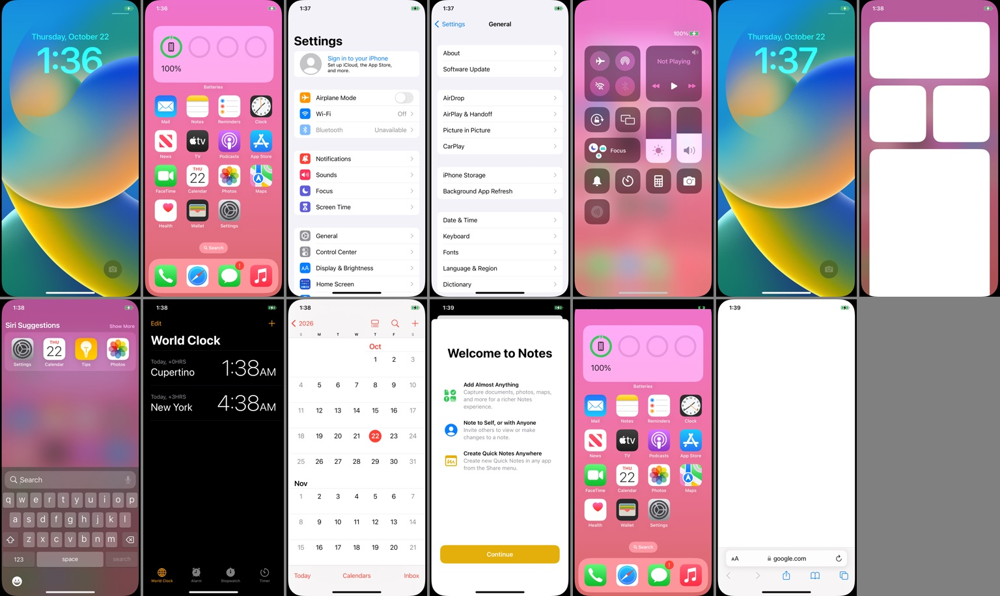

# IOS-26-Hot

[](https://github.com/nithinyadavamaraboina-online/IOS-26-Hot/actions/workflows/xnu.yml)
[](https://github.com/nithinyadavamaraboina-online/IOS-26-Hot/actions/workflows/userland.yml)

**Apple's iOS 26.5.2 (`23F84`, Liquid Glass `arm64e`) running natively on Qualcomm Snapdragon 855 (`SM8150` / Adreno 640) — Realme X2 Pro (`RMX1931`) & Google Pixel 4 (`flame`).**

`IOS-26-Hot` rebases and extends the open-source `SWEET` XNU port onto **`xnu-12377.121.6` (Darwin `25.5.0`, the iOS 26 generation)** and boots an unmodified **iPhone 11 Pro (`D421AP`) iOS 26.5.2 (`23F84`)** userland directly from UFS 3.0 storage — complete with GPU-accelerated **Liquid Glass** compositing on Adreno 640 (`HotMetal2` + Mesa Turnip + `metal2vulkan`), 2.4/5 GHz Wi-Fi, LTE Cellular + CallKit voice calls, stereo `MAX98937` speaker/earpiece/mic audio (`HotAudio.driver`), **HotStore 2.0** (App Store discovery, `arm64`/`arm64e` `.ipa` installer, per-app sandbox/Keychain runtime shim, and standalone WebApp packager), and **HotAuth** (microG-style Apple Account & iCloud compatibility layer).



> [!CAUTION]
> **Experimental research bring-up — not a production daily-driver OS.** Writing the iOS HFS+ root image to `userdata` replaces Android's user data partition, Apple's SEP/Secure Enclave hardware security model is replaced by software stubs (`cs_integrity_skip=1`, non-SEP `SweetKeyStore`), and bootloader partitions (`abl`, `xbl`, `tz`, `modem`, `persist`) must **never** be modified or relocked. Always back up your per-device partitions first — see [RECOVERY.md](RECOVERY.md).

---

## Hardware & Subsystem Status (iOS 26.5.2 / Kernel `0150` on `RMX1931`)

| Subsystem | Status | Implementation Details |
| --- | --- | --- |
| **Boot Chain** | **Working** | Unlocked ABL -> bare-metal `shim` (`Image.gz-dtb` + AVB v1.0 footer) -> `xnu-12377.121.6` (`DEVELOPMENT_ARM64_SWEET`) + dynamic POSIX ustar root overlay |
| **CPU & Thermals** | **Working** | All 8 Kryo 485 cores (`4x A55` + `3x A76` + `1x A76 Prime @ 2.84 GHz`), 3-tier dynamic OSM DVFS (`flamecpufreq=3`) + SMP2P proxy-vote handover (`~32.2–34.4 °C`, `36 mA` idle) |
| **ARMv8.3 PAC / `arm64e`** | **Working** | EL1 `locore.s` ~45-cycle PAC trap fast-path + offline/on-device `arm64e` PAC opcode stripping while preserving `DYLD_CHAINED_PTR_ARM64E` fixups for `dyld-1378` |
| **Storage** | **Working** | Qualcomm UFSHCI 3.0 (`sda16` on `RMX1931`, `sda15` on `flame`), case-sensitive HFS+ (`HFSX`) read/write root + HFS+-compatible `containermanagerd` ACL/protection shims |
| **Display & Dimming** | **Working** | Full-bleed `20:9` (`1125x2499 -> 1080x2400` Samsung `SOFEF03F-M` AMOLED), 60 Hz `gpu_direct` `BGRA` swapchain, `AppleARMBacklight` 0–625 nit OLED dimming + Tap-to-Wake |
| **GPU / Metal (`HotMetal2`)** | **Working** | `HotMetal2.bundle` (`NativeBridgeMetalFrontend` + `metal2vulkan` + Mesa `Turnip` Vulkan on Adreno 640 @ `675 MHz`, `hotmtl=2`), transient Liquid Glass render-target pooling, `MTLLinkedFunctions`, crisp Liquid Glass icons |
| **Touch & Buttons** | **Working** | Synaptics `S3706` RMI4 over QUPv3 GENI I2C (`4 ms` active poll, 10-finger multi-touch) on `RMX1931`; ST `ftm5` SPI touch on `flame`; PM8150 Power / Volume keys |
| **Wi-Fi (`en0`)** | **Working** | Userland `wland` driving Qualcomm `WCN3990` (`QRTR` + `PD-Mapper` `wlan_pd` + `QMI WLFW` + `CE/HTT/WMI`), active 2.4/5 GHz Probe Request scanning, WPA2/WPA3, native `Settings -> Wi-Fi` (`IO80211`) |
| **Cellular & Voice Calls** | **Working** | `cellulard` (`CoreTelephony` XPC + `QMI UIM/DMS/NAS/WDS/VOICE` over `/var/run/hot-qrtr.sock`), physical USIM + LTE registration, incoming/outgoing `CallKit` UI + audible ringtone |
| **Audio (`adspd` + `HotAudio`)** | **Working** | SM8150 LPASS ADSP PAS bring-up + `Q6AFE`/`Q6ADM`/`Q6ASM` + `Q6Voice` (`CVD v2.3`), stereo `MAX98937` speaker amps + earpiece + mic via `HotAudio.driver` CoreAudio HAL |
| **App Store & 3rd-Party Apps** | **Working** | **`HotStore 2.0`** (`itunes.apple.com` live charts/search + multi-repo unencrypted `.ipa` catalog + Wi-Fi `.ipa` dropzone + 1-tap `WKWebView` `HotWebAppStub` packager) + **`libhot_appfix.dylib`** (`@userapps` container, AppGroup, `-34018` Keychain & StoreKit/APNs compatibility layer) |
| **Apple Account & iCloud** | **Working** | **`HotAuth.app` + `hotauthd`** ("microG for iOS"): Self-Check diagnostics, 100% on-device native `CardDAV`/`CalDAV`/`IMAP` provisioning (Contacts, Calendar, Mail, Notes via App-Specific Password), persistent `icloud.com` WebKit container, and `akd`/`cdpd` bridge |
| **USB Debugging & SSH** | **Working** | Synopsys `DWC3` USB Ethernet: `dropbear` root SSH (`:22`), kernel file server & live telemetry hub (`hotdiag` / `hot-dbg.py` on `:2223`) |

**Not working yet:** FairPlay-encrypted (`cryptid = 1`) App Store binaries (use decrypted `.ipa` builds or 1-tap `HotStore` WebApps), Cellular packet data (`rmnet_ipa0`), hardware camera (`cameracaptured`), Bluetooth (`bluetoothd`), GPS (`locationd`), and hardware SEP / Face ID / Apple Pay.

---

## Architecture

```
Unlocked Qualcomm Bootloader (ABL)
  └── shim (shim/build-rmx1931.sh) — bare-metal iBoot replacement (EL1)
        • Preserves ABL cont_splash framebuffer, configures SMMU/PON/WDT, unpacks SWEETXNU v2 payload + ADT
        ▼
XNU 12377.121.6 (xnu/patches-26/0001..0150) — Darwin 25.5.0 (DEVELOPMENT_ARM64_SWEET)
  ├── Built-in Silicon Drivers: UFSHCI 3.0, SDE Display, Adreno 640 (/dev/sweet_gpu + /dev/pmem),
  │   Synaptics S3706 I2C Touch, DWC3 USB, PM8150 SPMI/RTC/Battery, Kryo 485 OSM DVFS, Apple80211 en0
  ├── ARMv8.2 -> ARMv8.3 Compatibility: locore.s PAC fast-path + sleh.c instruction emulator
  └── Non-SEP Security & Exec Injection: SweetKeyStore (1024 B wrap/unwrap + bag ops) + @userapps kern.exec_inject
        ▼
iOS 26.5.2 (23F84) Userland + IOS-26-Hot Daemons & Apps (phone/)
  ├── HotMetal2.bundle     — Metal -> metal2vulkan -> Mesa Turnip (Adreno 640 Vulkan 1.3, hotmtl=2)
  ├── wland + qrtr_mux     — MPSS remoteproc, rmtfs, pd-mapper (wlan_pd + audio_pd), WCN3990 802.11ac
  ├── cellulard + adspd    — CoreTelephony XPC + QMI LTE/Voice + LPASS ADSP + HotAudio.driver
  ├── HotStore 2.0         — hotstored (:29170 / LAN :29172) + HotWebAppStub + libhot_appfix.dylib
  └── HotAuth              — hotauthd (:29171) + HotAuth.app + libhot_sysfix.dylib (akd / cdpd / MCM)
```

---

## Repository Layout

| Path | Description |
| --- | --- |
| `xnu/patches-26/` | **150 sequential patches (`0001`–`0150`)** porting Apple's `xnu-12377.121.6` (iOS 26 / macOS 26.5) to `SM8150` |
| `xnu/patches/` | Legacy `0001`–`0128` patch series for `xnu-8796` (iOS 16.7.16) |
| `shim/` | Bare-metal ARM64 bootloader shim (`build-rmx1931.sh` for Realme X2 Pro, `build.sh` for Pixel 4) |
| `phone/metal2/`, `phone/turnip/` | `HotMetal2.bundle` (`HotMetal2.mm` + `NativeBridgeMetalFrontend.mm`), `metal2vulkan` Rust bridge patches, and Mesa Turnip iOS patches |
| `phone/wifi/` | `wland` userland Qualcomm MPSS + WCN3990 Wi-Fi driver, `rmtfs`, `pdmapper`, `servreg`, and multi-client `qrtr_mux` |
| `phone/cellular/` | `cellulard` (`CoreTelephony` XPC server + QMI `UIM`/`DMS`/`NAS`/`WDS`/`VOICE`) and `qmicli` |
| `phone/adsp/`, `phone/audio/` | `adspd` SM8150 LPASS ADSP audio/voice daemon (`MAX98937` + `Q6Voice`), `hot-audiotest`, and `HotAudio.driver` CoreAudio HAL |
| `phone/store/` | `HotStore.app` 2.0, `hotstored` v2 (embedded `arm64e` de-PAC + 4 KB SHA-256 signer + WebApp packager), `HotWebApp.m`, and `libhot_appfix.dylib` |
| `phone/auth/` | `HotAuth.app` and `hotauthd` (Self-Check, native iCloud CardDAV/CalDAV/IMAP provisioning, `icloud.com` WebKit, Anisette v1/v3 bridge) |
| `phone/media/` | `libhot_sysfix.dylib` (`containermanagerd` HFS+/persona shims, `backboardd` OLED calibration & 8-bit `BGRA`, `SpringBoard` JPEG snapshots, `akd`/`cdpd` hooks) & `libhot_media.dylib` |
| `phone/tools/` | On-device CLI utilities (`hotdiag`, `lsreg`, `openapp`, `oslog`, `psx`, `pstack`, `prefs`, `nettest`, `hot-bootprep`, `hot-idle-xpc`) |
| `tools/` | Host build & bring-up tools (`make-ios26-overlay.py`, `mkadt.py`, `mkpayload.py`, `de-pac-arm64e.py`, `rmx1931-run.ps1`, `hot-dbg.py`, `hot-init-v84.S`, `flame-files.py`) |
| `.github/workflows/` | Automated macOS CI builds for XNU (`xnu.yml`) and the complete `IOS-26-Hot` userland + Turnip + `HotMetal2` bundle (`userland.yml`) |
| [NOTES.md](NOTES.md), [HANDOFF.md](HANDOFF.md) | Hardware register map, ABL boot image rules, patch index, and chronological bring-up engineering log |
| [DEVICE.md](DEVICE.md), [RECOVERY.md](RECOVERY.md) | Target device specifications (`RMX1931` & `flame`), partition backup rules, and stock Android restoration |

---

## Not in Git (What You Provide Yourself)

This repository contains **source code, build scripts, and patches only**. No Apple IPSW binaries, Qualcomm/Google/Oppo firmware blobs, or device partition dumps are stored in git:

1. **Unlocked Target Phone & Backups**:
   - **Realme X2 Pro (`RMX1931` / `samurai`)** (or Google Pixel 4 `flame`) with an unlocked bootloader and TWRP in `recovery`.
   - Back up your per-device partitions (`boot`, `dtbo`, `persist`, `modemst1`, `modemst2`, `fsg`, `fsc`, `oppostanvbk`, `oppodycnvbk`) into `backup/` before touching `userdata` — keep `backup/` strictly private.
   - Extract `stock/dtb` from your stock `boot.img` and keep `avbtool.py` in `downloads/avb/`.
2. **Qualcomm Firmware (from your phone's own `/vendor/firmware_mnt` & NV backups)**:
   - Adreno 640: `a640_gmu.bin`, `a640_zap.mdt`/`.b00`–`.b02`, `a630_sqe.fw`.
   - Modem / Wi-Fi / ADSP (staged on-phone under `/var/local/fw/`): `modem.mdt`/`.b*`, `wlanmdsp.mbn`, `adsp.mdt`/`.b*`, `bdwlan*`, and your device's own `modemst1`/`modemst2`/`fsg`/`fsc` images.
3. **iOS 26.5.2 (`23F84`) Root Image**:
   - Obtain the official iPhone 11 Pro (`iPhone12,3` / `D421AP`) iOS 26.5.2 (`23F84`) IPSW directly from Apple.
   - Assemble the case-sensitive HFS+ (`HFSX`) root image (OS + SystemOS + AppOS Cryptexes), run `tools/de-pac-arm64e.py` across binaries/stub subcaches and `tools/sweet-root-tweaks.py`, and stream it to `userdata` (`/dev/block/sda16` on `RMX1931`) via TWRP `dd bs=4194304`.

---

## Building & Booting (`RMX1931`)

1. **Build Kernel & Userland (via GitHub Actions or macOS Xcode 16 + LLVM)**:
   - Trigger `.github/workflows/xnu.yml` -> produces `kernel.development.sweet` (`xnu-12377.121.6` + `0001..0150`).
   - Trigger `.github/workflows/userland.yml` -> produces `ios-userland.tar.gz` (`HotMetal2.bundle`, `wland`, `cellulard`, `adspd`, `HotAudio.driver`, `HotStore.app`, `HotAuth.app`, `hotstored`, `hotauthd`, `libhot_*.dylib`, and CLI tools).

2. **Assemble Root Overlay, Payload & Boot Image**:
   ```bash
   # 1. Build deterministic POSIX ustar root overlay
   python3 tools/make-ios26-overlay.py \
     -o work/boot/ios26-overlay.tar \
     --root-img ~/ios26-root-rmx1931.img \
     --dsc-stubs-dir work/boot/dsc-stubs-depac \
     --hotmetal2 work/boot/ios-userland/Extensions/HotMetal2.bundle \
     --userland-dir work/boot/ios-userland \
     --timezone Asia/Kolkata \
     --enable-cellular --enable-adsp \
     --wland-wrapper /private/var/local/bin/hot-bootprep

   # 2. Pack XNU 0150 + Apple Device Tree + overlay into SWEETXNU v2 payload
   python3 tools/mkpayload.py \
     work/boot/kernel-26-0150 \
     work/boot/rmx1931-d421ap-20x9-bb.adt \
     work/boot/payload-rmx1931.bin \
     --overlay work/boot/ios26-overlay.tar \
     --cmdline "debug=0xc serial=3 cpus=8 keepsyms=1 -enable_kprintf_spam -noprogress rd=ufsroot0 ufsrw=1 rootrw=1 cs_integrity_skip=1 fips_mode=0x44 unentitled_ios_sim_launch=1 ignition_level=1 wdt_test=no_user_checkin launchd_unsecure_cache=1 wdt=-1 sweetfb_noconsole=2 sweetfb_direct=1 sweetfb_hz=60 sweetiolog=- sweetgpu=1 hotmtl=2 sweetgpufreq=6 sweetusb=2 sweetusbframes=0 flamecpufreq=3 rmxtouchdelay=2 flamereboot=180"

   # 3. Wrap into 96 MiB RMX1931 AVB v1.0 boot image
   bash shim/build-rmx1931.sh work/boot/payload-rmx1931.bin shim/out/shim-rmx1931-test.img
   ```

3. **Guarded Test Boot (Auto-Restores `backup/boot.img`)**:
   ```powershell
   powershell -ExecutionPolicy Bypass -File tools\rmx1931-run.ps1 -Image shim\out\shim-rmx1931-test.img -TimeoutSeconds 200
   ```

---

## Credits & Licences

Built upon [ios-sweet](https://github.com/dipa-studio/ios-sweet), Apple's [darwin-xnu](https://github.com/apple-oss-distributions/xnu) (`APSL-2.0`), [UniXNU](https://github.com/UniXNU/UniXNU) & [UniXNU-zeta](https://github.com/none24smu/UniXNU-zeta), [metal2vulkan](https://github.com/steelbrain/metal2vulkan), [Mesa Turnip](https://gitlab.freedesktop.org/mesa/mesa), [ios-topaz](https://github.com/MakrSas/ios-topaz), and [HackiOS](https://github.com/oosexgang/hackios-xnu-kernel). Full licence breakdown in [CREDITS.md](CREDITS.md) and [LICENSE](LICENSE).
